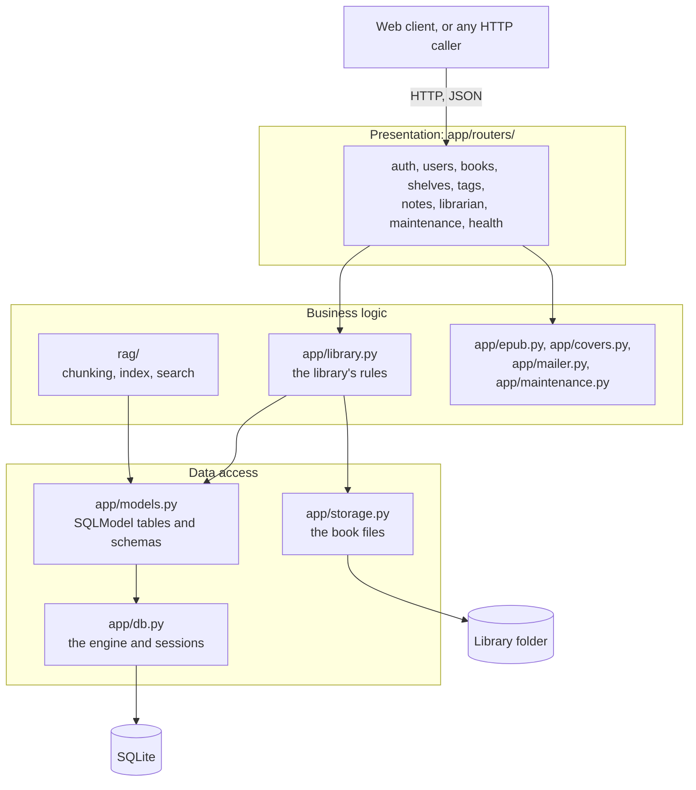

# Libra: the back-end block

This page is for the expert who checks the back-end part of the diploma
project "A Passage Retrieval System for an E-book Library Using LLM-Generated
Semantic Descriptors". It says how to reach and run the server, and where each
requirement of the "Minimum Backend Requirements" rubric is met.

| | |
|---|---|
| Repository | https://github.com/eugene-chekan/libra (public, read access for everybody) |
| The server | the folder [`backend/`](https://github.com/eugene-chekan/libra/tree/main/backend) on the branch `main` |
| Deployed application | https://libra-production-7f573af6.up.railway.app, on Railway. The interactive API page is at https://libra-production-7f573af6.up.railway.app/docs |
| API description | [`docs/frontend/api.md`](../frontend/api.md), the schema [`openapi.json`](../frontend/openapi.json), and the live page `/docs` |
| This page | the folder `docs/backend/` on the branch `docs/diploma` |

## Which part is the diploma's work

Libra is a self-hosted e-book library. Its server was built before the
diploma topic was set; the diploma adds a retrieval layer to it.

| Part of the server | Where | Part of the diploma? |
|---|---|---|
| Accounts, books, shelves, tags, notes, reading state, Kindle delivery, admin tools | `backend/app/` | No. It is the platform that the diploma builds on |
| **The retrieval layer**: chunking the book text, the search index, BM25, dense search, rank fusion, the evaluation measures | **[`backend/rag/`](https://github.com/eugene-chekan/libra/tree/main/backend/rag)** on `main` | **Yes** |
| **The retrieval experiment**: semantic descriptors written by an LLM, the descriptor search, the evaluation run | the branch [`diploma/experiment`](https://github.com/eugene-chekan/libra/tree/diploma/experiment/backend/rag) | **Yes**. It stays off `main` until the experiment ends |
| **The Librarian endpoint** that shows the found passages | `backend/app/routers/librarian.py` | **Yes**, in Part 2, due on 6 January 2027 |

**The Librarian endpoint gives a canned reply today.** The conversation, the
questions and the replies are real rows in the database, and the reply names a
real book from the library. But the reply text comes from a template in
[`app/librarian.py`](https://github.com/eugene-chekan/libra/blob/main/backend/app/librarian.py),
and the panel says "NOT CONNECTED". Part 2 replaces this one module with a call
to `rag.search`. Every other endpoint works with real data.

So wherever the retrieval layer has an example of a requirement, the tables
below name it first, in bold.

## How to run

### Way 1: the deployed copy

Open https://libra-production-7f573af6.up.railway.app and sign in with the demo account that comes with this
page. The library holds a few public-domain books.

### Way 2: Docker

You need Docker and Git.

```bash
git clone https://github.com/eugene-chekan/libra.git
```

```bash
cd libra
```

```bash
LIBRA_ADMIN_PASSWORD=choose-one docker compose -f scripts/docker-compose.yml up --build
```

Open http://localhost:8000 and sign in as `admin` with the password you chose.

### Way 3: from the source code

You need Python 3.12 or newer and [uv](https://docs.astral.sh/uv/). From
`backend/`:

```bash
uv sync --all-groups
```

```bash
uv run uvicorn app.main:app --reload
```

The API answers on http://localhost:8000/api, and its interactive page is
http://localhost:8000/docs.

### Tests and checks

From `backend/`:

| Command | What it runs |
|---|---|
| `uv run pytest --cov` | All 730 tests, with the coverage of `app` and `rag`. Fails below 90% |
| `uv run ruff check .` | The linter |
| `uv run ruff format --check .` | The formatter, checking only |

## The minimum requirements, one by one

| Requirement | Where | Notes |
|---|---|---|
| A modern framework | [`app/main.py`](https://github.com/eugene-chekan/libra/blob/main/backend/app/main.py) | FastAPI, on uvicorn |
| A database | [`app/db.py`](https://github.com/eugene-chekan/libra/blob/main/backend/app/db.py) | SQLite, relational. The database block describes it in full |
| An ORM | [`app/models.py`](https://github.com/eugene-chekan/libra/blob/main/backend/app/models.py) | SQLModel, built on SQLAlchemy. Alembic migrations create the tables |
| Layered architecture | [Layers](#layers) | Routers, the business layer, data access |
| SOLID | [SOLID](#solid) | An example from the code for each principle |
| API description | `/docs` on the server; [`api.md`](../frontend/api.md); [`openapi.json`](../frontend/openapi.json) | FastAPI makes the OpenAPI schema from the code, so it cannot drift from it |
| Global error handling | [Errors](#errors) | One handler turns any error no route handled into JSON |
| Logging | [Logging](#logging) | One JSON object per line, with named key events |
| Production deployment | [Deployment](#deployment) | Railway, deployed from `main` |
| Test coverage of at least 70% | [Tests](#tests) | 96.8%, measured with `pytest-cov` |

### Layers



- **Routers** read the request, check who is asking, call the business layer,
  and turn its exceptions into HTTP status codes. For example,
  `library.BookNotFoundError` becomes 404 in
  [`routers/books.py`](https://github.com/eugene-chekan/libra/blob/main/backend/app/routers/books.py).
- **The business layer** holds the rules: who may see a shelf, how a book is
  deleted with everything that points at it, how a reader's state is merged
  into a book. It raises its own exceptions and knows nothing about HTTP. The
  reasons for this split are in
  [layering.md](https://github.com/eugene-chekan/libra/blob/main/docs/specs/layering.md).
- **Data access** is SQLModel sessions and the storage module. The project has
  no separate repository layer, because a SQLModel session already is one.

**What does not follow the rule yet.** A few simple routers still run a query
directly, such as listing users and editing a book. They were written before
the rule was adopted. The Librarian router followed the same pattern until PR #191 moved
its database code into `library.py`.

### SOLID

| Principle | Example in the code |
|---|---|
| Single responsibility | [`storage.py`](https://github.com/eugene-chekan/libra/blob/main/backend/app/storage.py) only moves files and knows nothing about books; [`epub.py`](https://github.com/eugene-chekan/libra/blob/main/backend/app/epub.py) only reads EPUB files and knows nothing about storage. The upload router puts them together in a fixed order |
| Open/closed | **`rrf()` in [`rag/search.py`](https://github.com/eugene-chekan/libra/blob/main/backend/rag/search.py) merges any number of rankings.** A new search method adds its own ranking function; the fusion and the evaluation do not change |
| Liskov substitution | **`FakeEmbedder` in [`tests/fake_embedder.py`](https://github.com/eugene-chekan/libra/blob/main/backend/tests/fake_embedder.py) stands in for the real embedding model** everywhere the tests index or search, and the code under test cannot tell the difference |
| Interface segregation | **The [`Embedder`](https://github.com/eugene-chekan/libra/blob/main/backend/rag/embeddings.py) protocol asks for two methods only**, `embed` and `token_count`, not the model library's whole class. A route asks only for what it needs: `get_session`, `get_settings`, `current_user` or `require_admin` |
| Dependency inversion | Routers receive their session, settings, current user and mail sender through FastAPI's `Depends`. The tests replace each one ([`tests/conftest.py`](https://github.com/eugene-chekan/libra/blob/main/backend/tests/conftest.py)): a temporary database, test settings, a fake mail sender that sends nothing |

### Errors

- **Unhandled errors.** [`unhandled_error`](https://github.com/eugene-chekan/libra/blob/main/backend/app/main.py)
  answers every error that no route handled with status 500 and
  `{"detail": "The server ran into a problem. Try again in a moment."}`. It
  logs the error with its traceback as the event `unhandled_error`. The answer
  never shows the cause.
- **Expected errors.** The business layer raises named exceptions, such as
  `BookNotFoundError`, `ShelfNotOwnedError` and `DuplicateTagNameError`. The
  routers turn them into the right status code with a sentence in `detail`.
- **Wrong input.** FastAPI checks every request body against its model and
  answers 422. The models also trim and check fields: a book needs a title and
  an author, and a Kindle address must look like one.

| Status | When |
|---|---|
| 200, 201, 202, 204 | Read, created, accepted (Kindle delivery), deleted |
| 401 | Not signed in, or the session has ended |
| 403 | Signed in, but not allowed, such as a reader on an admin route |
| 404 | Not there, or another reader's private item |
| 409 | A name already taken, or deleting your own account |
| 413, 415, 422 | A file too large, not an EPUB, or a wrong value |
| 500, 502, 503 | An unexpected error; the mail server failed; Kindle delivery is not set up |

### Logging

The server writes one JSON object per line when `LIBRA_LOG_FORMAT=json`, and
the Docker image sets it. A log collector can read each line without parsing
text:

```json
{"time": "2026-11-24T20:13:45.715+00:00", "level": "INFO", "logger": "libra.routers.books", "message": "anna added the book 1", "event": "book_uploaded", "book_id": 1, "by_user_id": 1}
```

- **Key events**, each with an `event` name: `sign_in`, `sign_out`,
  `user_created`, `user_updated`, `user_deleted`, `book_uploaded`,
  `book_updated`, `book_deleted`, `book_sent_to_kindle`,
  `librarian_question`, `sessions_pruned`, `database_vacuumed`,
  `orphan_deleted`.
- **Errors**: `unhandled_error` with the traceback, a failed sign-in, a failed
  mail delivery, and a database schema upgrade on start.
- **Never logged**: a password, a session token, the text of a note or of a
  question, a Kindle address. A changed account logs the names of the changed
  fields, never their values.

The code is in
[`logging_config.py`](https://github.com/eugene-chekan/libra/blob/main/backend/app/logging_config.py).
On Railway, the logs are in the service's "Logs" tab.

### Deployment

The demo runs on Railway at https://libra-production-7f573af6.up.railway.app.

- **From the repository.** Railway builds the image from `backend/Dockerfile`
  on every push to `main`. **Wait for CI** is on, so a commit whose GitHub
  Actions checks fail is never deployed.
- **The image** is built from the same Dockerfile as the release image on
  `ghcr.io/eugene-chekan/libra`. It runs the server as the user `libra`, not
  `root`, and runs the database migrations when it starts.
- **Data** lives on a Railway volume at `/app/data`, so a new deploy keeps the
  books and the accounts.
- **Secrets** live in Railway's variables only: the admin password and the
  database path. The repository holds none.

Every setting is listed in the main README, under
["Deploying to Railway"](https://github.com/eugene-chekan/libra#deploying-to-railway).

### Tests

`uv run pytest --cov` runs **730 tests** and measures **96.8%** of the
statements in `app` and `rag`. CI runs it on every pull request, and fails
below 90%.

| Module | Coverage |
|---|---|
| **`rag/chunking.py`, `rag/index.py`, `rag/search.py`, `rag/metrics.py`** | **100%** |
| `app/library.py` (the business layer) | 99% |
| `app/models.py`, `app/main.py`, `app/logging_config.py` | 100% |
| Lowest: `app/mailer.py` | 86% |

Each new rule is checked by hand: break it, and confirm that a test fails.

## Constraints

| The rubric asks | In Libra |
|---|---|
| No paid libraries | All are free and open: FastAPI, SQLModel, Alembic, argon2-cffi, fastembed, numpy |
| Avoid vulnerable packages | `pip-audit` on 2026-11-24: one package left, `pillow` 12.3.0. Libra never passes an image to it: only `fastembed` imports it, for image models that Libra does not use. Version 13 needs a newer `fastembed`, and the experiment is frozen on `fastembed` 0.9.0, so the upgrade waits until the experiment ends. `npm audit`: the code that ships to the browser has no known issue |
| Version control | Git, with every change in a reviewed pull request |
| JSON | Every request and answer is JSON, except the EPUB upload and download and the Librarian's event stream |
| Secrets in the environment | All settings come from `LIBRA_*` variables ([`config.py`](https://github.com/eugene-chekan/libra/blob/main/backend/app/config.py)). The repository holds no key and no real password |
| Automatic deployment from the repository | Railway deploys `main` after CI passes. A release also publishes the image to GHCR ([`release.yml`](https://github.com/eugene-chekan/libra/blob/main/.github/workflows/release.yml)) |

| The rubric does not allow | In Libra |
|---|---|
| Your own encryption | Passwords use Argon2id from `argon2-cffi`; session tokens come from Python's `secrets` and are stored as SHA-256 hashes |
| Outdated or teaching-only libraries | None. The server is FastAPI on uvicorn |
| Stubs instead of a real API | Every endpoint works with the database, except the Librarian's reply text, which is canned until Part 2. See [Which part is the diploma's work](#which-part-is-the-diplomas-work) |
| All code in one file | 28 modules in `app/` and 9 in `rag/` |

## The common mistakes, checked

| Mistake | In Libra |
|---|---|
| Insecure hashing | Argon2id with the RFC 9106 settings; SHA-256 only for random session tokens |
| Sensitive data in plain text | Passwords and session tokens are stored only as hashes |
| Missing input validation | FastAPI checks every body against its model; the models trim and check text fields; SQL is built only through SQLAlchemy, never from strings |
| Missing error handling | One global handler, and named exceptions in the business layer. See [Errors](#errors) |
| Wrong status codes | See the status table in [Errors](#errors) |
| Database does not match the documentation | The database block's `schema.sql` is generated from the migrations, and a test fails when the models and the migrations differ |
| Missing API documentation | `/docs`, `openapi.json`, `api.md` |
| Poor code quality | `ruff` lint and format in CI and in a pre-commit hook, and a written style guide ([code-style.md](https://github.com/eugene-chekan/libra/blob/main/docs/specs/code-style.md)) |
| Inefficient queries | Lists load related data in batches, not one query per row: one join for reading state, one grouped count for shelves and tags. Indexes on every lookup column (database block, Section 2.3) |
| Hardcoded configuration | All settings are `LIBRA_*` variables with safe defaults |
| No modularity | See [Layers](#layers) |
| Magic strings | Named constants, such as `SHELF_PUBLIC`, `SORT_TITLE`, `ROLE_READER`, `ROLE_LIBRARIAN`, and `Literal` types for each closed set of values |
| Code duplication | One rule, one place: every library rule is in `library.py`, which both the API and the command line call |
| No test coverage | 96.8%, see [Tests](#tests) |
| Not following REST | Resources are nouns (`/books/{id}/notes`), and methods match the action: GET reads, POST creates, PATCH edits, PUT replaces, DELETE removes. The few actions that are not a resource are POSTs with a verb, such as `send-to-kindle` and `prune-sessions` |

## Beyond the minimum

These are part of the "maximum" list, and already in place:

- **CI/CD.** GitHub Actions runs lint, tests with coverage, the client tests,
  end-to-end tests in a browser, and a test of the Docker image on every pull
  request. A version change publishes the image to GHCR for `amd64` and
  `arm64` and makes a GitHub Release. Railway deploys `main` after CI passes.
- **Quality gates.** CI fails on a lint error, a format error, a failed test,
  or coverage below 90%, and Railway does not deploy such a commit.

## What is not done yet

- **The Librarian's reply is canned** until Part 2 of the diploma connects it
  to `rag.search`, due on 6 January 2027.
- **`pillow` keeps known issues** until the experiment's freeze ends. Libra
  never runs them. See [Constraints](#constraints).
- **A few routers still run queries directly**, against the layering rule. See
  [Layers](#layers).
