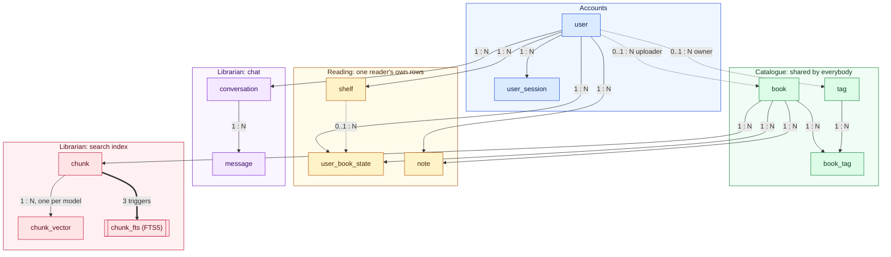
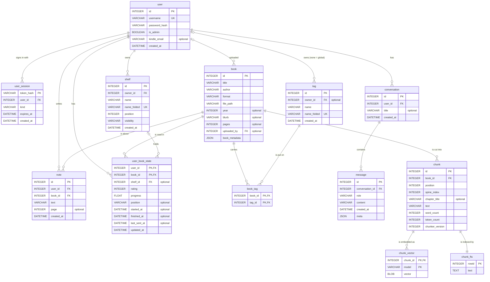

# The libra database

This document describes the database of libra, for the expert assessment of
the diploma project. It covers two parts:

- **The library**: accounts, the book catalogue, shelves, tags, reading state
  and notes.
- **The librarian**: the chat with the librarian, and the search index that
  lets the librarian find passages in the books.

Both parts live in one database. The document was checked against the code on
2026-11-14, on the branch `main` (schema revision `a6a7fa951ca6`).

| | |
|---|---|
| Kind of database | Relational, transactional (OLTP) |
| DBMS | SQLite 3 |
| Access from code | SQLModel (SQLAlchemy and Pydantic) |
| Structure is made by | Alembic migrations, kept in Git |
| Tables | 13 |

**Other files in this folder**

| File | What it is |
|---|---|
| [data-dictionary.md](data-dictionary.md) | Every table and column: type, key, meaning, rule |
| [schema.sql](schema.sql) | The DDL script. Generated from the migrations, never typed |
| [test-data.sql](test-data.sql) | Test rows for every table, with the edge cases |
| [dump_schema.py](dump_schema.py) | The script that writes `schema.sql` |

## Where each requirement is answered

The database is graded as a **transactional database (OLTP)**. It is the main
store of the application, not a helper for logs or settings. libra uses no
NoSQL database, so that part of the requirements does not apply.

| Requirement | Where |
|---|---|
| Data dictionary | [data-dictionary.md](data-dictionary.md) |
| Data integrity and transactions | [Integrity](#integrity), [Transactions](#transactions) |
| ER diagram, logical schema | [Logical schema](#logical-schema) |
| DDL script | [schema.sql](schema.sql) |
| Modern relational DBMS | [The DBMS](#the-dbms) |
| Normalisation to 3NF | [Normal forms](#normal-forms) |
| Tables and kinds of relationship | [Relationships](#relationships) |
| Keys, constraints, data types | [Keys and constraints](#keys-and-constraints), [Data types](#data-types) |
| Structure made by scripts, in Git | [Deployment and versions](#deployment-and-versions) |
| Test data and reference data | [Test data](#test-data) |
| Roles and access rights | [Roles and access](#roles-and-access) |
| Passwords | [Passwords and secrets](#passwords-and-secrets) |
| JSON in a relational database | [The two JSON columns](#the-two-json-columns) |
| Several DBMS, data layers | [Why one DBMS and one layer](#why-one-dbms-and-one-layer) |
| Versioning of the structure | [Deployment and versions](#deployment-and-versions) |
| Indexes, with reasons | [Indexes](#indexes) |
| Triggers, procedures, functions | [Logic inside the database](#logic-inside-the-database) |
| Views | [Logic inside the database](#logic-inside-the-database) |
| Personal data | [Personal data](#personal-data) |
| What is not done yet | [Limits and planned work](#limits-and-planned-work) |

---

## What the database is for

libra is a personal ebook library that a household runs on its own computer.
A few people share one set of books. Each person has their own shelves,
ratings, reading progress and notes. A "librarian" panel answers questions by
searching the text of the books.

The database must therefore do four things:

1. Keep the shared catalogue: one row for one book file.
2. Keep each reader's own data apart from every other reader's.
3. Keep accounts and sessions, so that a person can sign in.
4. Keep the librarian's conversations, and an index of the book text that
   search can use.

The book files themselves (EPUB) are not in the database. They are in a
folder next to it. The database holds each file's name.

## The DBMS

**SQLite 3**, the version that comes with Python. On the development machine
that is SQLite 3.50.4.

SQLite is a relational DBMS with full SQL, ACID transactions, foreign keys,
unique and partial indexes, triggers, JSON functions and a full-text search
engine (FTS5). libra uses all of these.

**Why SQLite fits this project.**

- libra is *local-first*: it runs on one home computer, for one household.
  There is one server process and a handful of users. No part of the task
  needs many servers writing at once.
- A person installs it with one command. SQLite needs no second service, no
  port, no database password and no administrator. PostgreSQL would add all
  four to a product whose point is that nobody has to look after it.
- The whole database is one file. A backup is a copy of that file and of the
  book folder.
- Search needs BM25 ranking. SQLite has it built in (FTS5), in the same
  database and the same transaction as the books.

**What SQLite costs.** It has no user accounts and no `GRANT`, so the roles
that the requirements name cannot be made inside it. See
[Roles and access](#roles-and-access). It has no stored procedures. It lets
only one writer work at a time, which is enough for a household.

**The way to PostgreSQL.** All table access goes through SQLModel, and the
database address is one setting (`LIBRA_DATABASE_URL`). Three things are tied
to SQLite and would be rewritten: the full-text index (FTS5), the replaced
`lower()` function, and the partial unique index on `tag`. PostgreSQL has its
own form of each.

### Why one DBMS and one layer

The requirements suggest several DBMS and several data layers "when needed".
Here they are not needed, and using them would make the project worse.

**One DBMS.** The first plan for search used Chroma, a vector database. The
plan changed to SQLite, for these reasons
([phase-2-plan.md](../specs/phase-2-plan.md#why-sqlite-not-chroma)):

- Deleting a book removes its search chunks in the same transaction. With two
  databases, the second delete can fail and leave passages of a book that no
  longer exists.
- BM25 is built in. Chroma would need one more library that rebuilds its
  index in memory at every start.
- Vector search is exact: every one of about 9,500 chunks is scored, in
  memory. A vector database would give approximate answers, and that would
  add a second cause to every difference the experiment measures.

The limit is size. About 500 books would mean about a million vectors. A
library of that size needs a vector index (`sqlite-vec`, or a vector
database). The tables stay the same.

**One database file.** A second SQLite file for "application state" was
considered (issue #110). The foreign keys rule it out. Every table is linked
to `user` or to `book`, and most to both: `user_book_state` points at a user,
a book and a shelf at once. Two SQLite files cannot check a foreign key
between them, and cannot be written in one transaction. Only `user_session`
points at nothing but `user`, and one table is not worth a second database
and a second migration history. The same issue plans a `setting` table for
the settings an admin changes; it is not designed yet.

**One layer.** Raw, staging and data-mart layers serve analytics: data comes
from outside, is cleaned, and is reshaped for reports. libra's data is typed
by its users or read from a book file at upload, and it is used in the shape
it is stored in. So every table is one layer of live data.

One thing is close to a raw layer, and it is kept outside the database on
purpose. The retrieval experiment saves every answer of the language model to
a log file in Git (`experiment/descriptors.jsonl`, planned). That log is the
source of truth, and the tables are filled from it.

---

## Logical schema

The tables form five blocks. The colours are the same in both pictures of
this section and in the [data dictionary](data-dictionary.md).

| Block | Tables | Meaning |
|---|---|---|
| Accounts (blue) | `user`, `user_session` | Who can sign in |
| Catalogue (green) | `book`, `tag`, `book_tag` | Shared by everybody |
| Reading (yellow) | `user_book_state`, `shelf`, `note` | One reader's own rows |
| Librarian: chat (purple) | `conversation`, `message` | One reader's talk with the librarian |
| Librarian: search index (red) | `chunk`, `chunk_vector`, `chunk_fts` | The book text, cut up for search |

### Blocks and relationships

An arrow goes from the "one" side to the "many" side. A dotted arrow means
the link is optional: the column on the "many" side may be empty.



### ER diagram

Every table with its columns and keys. `PK` is a primary key, `FK` a foreign
key, `UK` a unique column. "optional" marks a column that may be empty.



### Relationships

The schema has every common kind of relationship.

| Kind | Example | How it is built |
|---|---|---|
| One to many | A user has many shelves, notes, sessions. A conversation has many messages. A book has many chunks | A foreign key on the "many" side |
| Many to many | A book carries many tags, and a tag is on many books | The link table `book_tag`, with a primary key of both columns |
| Many to many, with data on the link | A reader reads many books, and a book is read by many readers | `user_book_state`, with the primary key `(user_id, book_id)`. The rating, the progress and the shelf sit on the link |
| Optional | A book may have no known uploader. A tag may have no owner (a global tag). A book may be on no shelf | A foreign key column that may be empty |
| One to one | A chunk has one entry in the full-text index | `chunk_fts.rowid` equals `chunk.id`, kept by triggers |

**The main design choice** is the line between shared data and one reader's
data. A book's title is the same for everybody, so it is in `book`. A rating
belongs to one reader, so it is in `user_book_state`. Two readers who rate
the same book at the same moment write two different rows and can never
overwrite each other. The reasons are in
[library-organization.md](../specs/library-organization.md#data-model).

---

## Design

### Normal forms

The schema is in third normal form, with the exceptions named below.

**First normal form.** Every column holds one value. A list is never packed
into a text column: the tags of a book are rows in `book_tag`, and the books
on a shelf are rows in `user_book_state`. The two JSON columns are the
exception, and they are described in
[The two JSON columns](#the-two-json-columns).

**Second normal form.** Three tables have a primary key of two columns. In
each of them, every other column needs the whole key:

- `user_book_state (user_id, book_id)`: a rating is about one reader *and* one
  book. Neither alone decides it.
- `book_tag (book_id, tag_id)`: there is no other column.
- `chunk_vector (chunk_id, model)`: the vector depends on the passage *and* on
  the model that made it.

**Third normal form.** No column depends on another column that is not a key.
Facts about a user are only in `user`. Other tables hold `user_id`, never the
user's name. The same is true for books, shelves and tags.

**The exceptions, each made on purpose.**

| Column | Why it breaks the rule | Why it is kept | What keeps it correct |
|---|---|---|---|
| `shelf.name_folded`, `tag.name_folded` | It is worked out from `name` | The unique index needs a form of the name that ignores case in every alphabet. SQLite's own rule (`NOCASE`) only knows the 26 ASCII letters, so "Фантастика" and "фантастика" were two tags | Code that runs before every insert and update of these tables sets it again from `name` (`_keep_folded_name_in_step` in `app/models.py`). No other code writes it |
| `book.author` | Several authors are joined into one text | It is the text the screen shows. Nothing searches or links by a single author | The full list stays in `book_metadata.authors` |
| `message.meta.citation.title` | It repeats `book.title` | It records what the librarian said at that moment. A later change of the title must not rewrite an old reply | Written once, never updated |
| `chunk.word_count`, `chunk.token_count` | They are worked out from `chunk.text` | Counting tokens needs the embedding model. The experiment reads these numbers often | A chunk is never changed after it is written |

`book.year` looks like one more exception, but it is not. It starts as a
value read from the date in the file, and after that it is its own fact: an
admin can correct it, and the raw date stays in `book_metadata.published` to
show what the file said.

### Keys and constraints

| Kind | How many | Notes |
|---|---|---|
| Primary key | Every table | A single number in most tables. Two columns in `user_book_state`, `book_tag` and `chunk_vector`. A hash in `user_session` |
| Foreign key | 15 | Every link between tables is declared, and SQLite checks each one on every write |
| `NOT NULL` | Every column that must have a value | A column may be empty only where "unknown" or "none" is a real answer |
| `UNIQUE` | 4 unique indexes and 1 unique constraint | `user.username`; a shelf name for one owner; a tag name for one owner; a global tag name; a chunk's position in a book |
| `CHECK` | 6 | The rating, the progress, the page count of a book, the page of a note, the visibility of a shelf, the role of a message |

The full list, column by column, is in the
[data dictionary](data-dictionary.md).

### Data types

| Data | Type | Why |
|---|---|---|
| Identifiers, counts, years, positions | `INTEGER` | Whole numbers |
| Reading progress | `FLOAT` | A share from 0 to 1 |
| Names, text | `VARCHAR` | Text of any length |
| Yes or no | `BOOLEAN` | Stored as 0 or 1 |
| Moments in time | `DATETIME` | Always UTC. A time is never kept as free text or as a number of seconds |
| Extra facts with a described shape | `JSON` | See the next section |
| Embedding vectors | `BLOB` | 32-bit floats as raw bytes. 3,072 bytes for one vector, against about 15,000 as JSON text |

libra stores no money, so no decimal type is needed.

### The two JSON columns

A relational database should not be used as a box for loose documents. libra
has two JSON columns. Each has a described shape, and each has a reason.

**`book.book_metadata`.** An EPUB file can carry many facts: language,
publisher, identifiers, subjects. libra shows none of them on a screen, never
filters by them, and never links by them. They are kept so that nothing the
file said is lost. Every fact that the application *does* use is a real
column: `title`, `author`, `year`, `blurb`, `pages`. When a fact starts to be
used, it moves to a column in a migration. This has happened once: revision
`69e4f2dbef24` moved `description` out of the JSON into the column `blurb`,
and moved the year into `year`.

**`message.meta`.** It records what the librarian did to make a reply: the
search step, and the book the reply points at. The shape will grow when the
librarian becomes an agent with several tools. Keeping it as JSON lets that
happen without a change of table for every new tool.

The keys of both columns are listed in the
[data dictionary](data-dictionary.md). Both are written by one piece of code
each, so the shape cannot drift.

---

## Integrity

Integrity is kept at three levels.

### 1. In the database

- Primary keys, foreign keys, unique indexes, `NOT NULL` and `CHECK` are
  enforced by SQLite on every write the application makes.
- **Foreign keys.** A row cannot point at a row that does not exist, and a
  row cannot be deleted while other rows point at it. SQLite checks foreign
  keys only on a connection that asks for it, so libra asks on every
  connection it opens (`PRAGMA foreign_keys = ON`, in `app/db.py`). Nothing
  cascades: the application deletes the child rows itself, and the database
  refuses the delete if it forgot one.
- **Value ranges.** Six `CHECK` constraints: a rating is 0 to 5, a progress
  is 0 to 1, a page count and a page number are 1 or more, a shelf is
  `private` or `public`, a message is from `user` or `librarian`.
- The composite key of `user_book_state` makes one rule a matter of
  structure: a reader has one row for a book, and that row has one `shelf_id`.
  So a book is on at most one shelf of a reader. No code has to check it.
- The partial unique index `ix_tag_global_name` closes a gap that the normal
  unique index leaves. SQL treats two empty values as different, so
  `(owner_id, name_folded)` alone would allow two global tags with one name.

**One limit of SQLite.** The foreign key setting belongs to a connection, not
to the database file. Another program that opens the file, such as the
`sqlite3` shell, must set it too. The `CHECK` constraints, the keys and the
unique indexes are in the file and hold for every program.

**Migrations run with the foreign key check off.** A migration that changes a
table in SQLite builds a new table and drops the old one, and SQLite refuses
to drop a table that rows point at. So the check is switched off while the
migrations run and switched on again after. A test upgrades a database that
holds a book on a shelf, and fails without this.

### 2. In the application

The rules for books, shelves, tags, reading state and notes are in one
module, `app/library.py`, so each rule exists in one place. The HTTP layer
and the command line both call it ([layering.md](../specs/layering.md)).

- **A parent is looked up before a child is written.** A note is written only
  after the book is found. A shelf is used only after it is found and its
  owner is checked.
- **Children are deleted before their parent, in one transaction.** Deleting
  a book first deletes its tag links, every reader's state for it and every
  note on it. The database refuses the delete if a child is left. This
  matters more in SQLite than elsewhere: SQLite can give the number of a
  deleted row to the next new row, so a row left behind would be inherited by
  a new book or a new user.
- **Rules that no foreign key can say.** A `shelf_id` must name a shelf of the
  same reader. A personal tag may not have the name of a global tag. A reader
  can read and write only their own state, notes and conversation.
- **Value ranges, a second time.** The request models check the same ranges
  as the `CHECK` constraints. A request with a wrong value is refused with a
  clear error before the database is touched. The constraints are for every
  other writer: a script, a migration, or a person with a SQLite shell.

### 3. In the tests

The rules above are application code, so they are only as good as their
tests. The backend has 567 test functions in 42 files, which run as 704
cases. They run before every push, and in CI on every pull request. Among
them:

- `test_models_and_migrations_agree` fails when a table in the code differs
  from what the migrations build.
- `test_every_route_requires_authentication` walks every route of the API and
  fails when one can be called without signing in.
- The tests of `delete_book` and `delete_user` check that nothing of a
  deleted book or user is left.
- `tests/test_check_constraints.py` writes a row that breaks each `CHECK`
  constraint, and a row with no parent, straight into the database. Each must
  be refused, both in a database built from the table classes and in one
  built by the migrations.

## Transactions

Each request gets its own database session. A function in `app/library.py`
makes all its changes and then calls `commit()` at the end. If anything
fails before that, nothing is written. SQLite's transactions are ACID, and it lets
one writer work at a time, so two transactions never mix.

Operations that change several rows, each in one transaction:

| Operation | What changes together |
|---|---|
| Delete a book | The book, its tag links, every reader's state for it, its notes (and its search chunks) |
| Delete a user | The user, their sessions, shelves, tags and tag links, state rows, notes, and their conversation with its messages. Their uploads stay, with `uploaded_by` emptied |
| Delete a shelf | The books on it move to another shelf of the same reader, or to no shelf, and the shelf goes |
| Reorder shelves | The position of every shelf of the reader |
| Delete a tag | The tag and every link to a book |
| Set the tags of a book | Old links out, new links in |

**Files and rows together.** A book is a row and a file, and a file system
has no transactions. The order of steps makes every failure safe:

- *Upload:* the file is saved under a temporary name, checked, moved to its
  final name, and then the row is inserted. If the insert fails, it is rolled
  back and the file is deleted.
- *Delete:* the rows are deleted and committed first, and the file is removed
  last. A failure can leave a file with no row. It can never leave a row with
  no file.

The admin's maintenance page lists both kinds of leftover: files that no row
points at, and rows whose file is gone.

---

## Indexes

Each index is there for a query that the application runs.

| Index | Table and columns | Why |
|---|---|---|
| `ix_user_username` (unique) | `user (username)` | Every sign-in looks a user up by name. It also makes the name unique |
| primary key | `user_session (token_hash)` | Every request with a cookie looks the session up by the token's hash |
| `ix_user_session_user_id` | `user_session (user_id)` | Deleting a user removes their sessions |
| primary key | `user_book_state (user_id, book_id)` | Saving reading progress is one lookup by key. Listing a reader's books uses the first column |
| `ix_note_user_id`, `ix_note_book_id` | `note` | The book page lists one reader's notes on one book |
| `ix_shelf_owner_name` (unique) | `shelf (owner_id, name_folded)` | A shelf name is unique for its owner, in any alphabet. It also serves "all shelves of this owner" |
| `ix_tag_owner_name` (unique) | `tag (owner_id, name_folded)` | The same, for personal tags |
| `ix_tag_global_name` (unique, partial) | `tag (name_folded) WHERE owner_id IS NULL` | A global tag name is unique. A partial index covers only the global tags |
| `ix_shelf_owner_id`, `ix_tag_owner_id` | `shelf`, `tag` | Made for the foreign key. The unique indexes above start with the same column, so these two add nothing and can be dropped |
| `ix_conversation_user_id` | `conversation (user_id)` | Opening the panel finds the reader's conversation |
| `ix_message_conversation_id` | `message (conversation_id)` | Loading a conversation reads its messages |
| `ix_chunk_book_id` | `chunk (book_id)` | Deleting or re-indexing a book finds its chunks |
| `uq_chunk_book_version_position` (unique) | `chunk (book_id, chunker_version, position)` | A book cannot be indexed twice. It is also the identity of a chunk in the experiment |
| `chunk_fts` | full-text index on `chunk.text` | Word search with BM25 ranking |

**Left without an index on purpose.** The catalogue search looks for a piece
of text anywhere inside `title` or `author`. An ordinary index cannot help
that kind of search, and a home library is a few thousand rows at most, a
small table to read in full.

## Logic inside the database

**Triggers.** Three triggers on `chunk` keep the full-text index correct
(`chunk_ai` after insert, `chunk_ad` after delete, `chunk_au` after update).
No code that writes a chunk has to remember the index, and the index changes
in the same transaction as the row. See
[The search index](#the-search-index).

**A user-defined function.** libra replaces SQLite's `lower()` with its own
function (`app/db.py`). SQLite's `lower()` only changes the 26 ASCII letters,
so a search for "долгая" did not find "Долгая". The new function folds case
in every alphabet. It is registered on every connection, so every query that
compares text without case is correct, not only the one that was fixed
first. The function lives in the application, not in the database file:
another program that opens the file gets SQLite's own `lower()`.

**Stored procedures.** SQLite has none. The logic that would be a procedure
in PostgreSQL is in `app/library.py`.

**Views.** There are none today. What the application shows about a book
depends on who asks (their rating, their shelf, their tags), and that merge
is done in `app/library.py`. See
[Limits and planned work](#limits-and-planned-work).

---

## Deployment and versions

**Nothing is created by hand.** The structure is made by Alembic migrations
in `backend/alembic/versions/`. Each migration is a Python file with an
`upgrade` and a `downgrade` step. The application runs the missing ones every
time it starts, so an installation updates itself. The setting
`LIBRA_AUTO_UPGRADE_DB=false` turns that off for a person who wants to run
them by hand.

**How a change is made.**

1. Change the table class in `backend/app/models.py`.
2. Let Alembic write the migration by comparing the classes with a database.
3. Read it, and add what Alembic cannot know: names for constraints, and the
   steps that move existing data.
4. Commit the class and the migration together.

The test `test_models_and_migrations_agree` fails if step 2 was skipped.

**The history.** The database records its revision in the table
`alembic_version`. The files are in Git, so every change has an author, a
date and a reason.

| # | Revision | Date | What it does |
|---|---|---|---|
| 1 | `45e89aabeb7c` | 2026-08-03 | The first table: `book` |
| 2 | `d34d899bf315` | 2026-08-04 | `user`, `user_session` |
| 3 | `69e4f2dbef24` | 2026-08-08 | `note`, `user_book_state`; four new columns on `book`. Moves existing data: the description and the year out of the JSON, and the uploader |
| 4 | `afb8fd54343f` | 2026-08-08 | `shelf`; `user_book_state.shelf_id` |
| 5 | `9a8d5d47149e` | 2026-08-08 | `tag`, `book_tag` |
| 6 | `d9731df616b0` | 2026-08-24 | Data only: spaces in tag names become hyphens |
| 7 | `12214bf85cad` | 2026-08-28 | `conversation`, `message` |
| 8 | `8be05e88e049` | 2026-09-03 | `user_book_state.position` |
| 9 | `fcb90b64ac72` | 2026-09-07 | `name_folded` on `shelf` and `tag`, and the unique indexes move to it |
| 10 | `ede8e57ae05c` | 2026-09-14 | Data only: clears years that were really a file's build date |
| 11 | `c06126bfeef6` | 2026-11-14 | Data only: deletes conversations that deleted users left behind |
| 12 | `58dc777b7e31` | 2026-11-14 | The six `CHECK` constraints. First repairs any value out of range |
| 13 | `a6a7fa951ca6` | 2026-10-18 | `chunk`, `chunk_vector`, `chunk_fts` and its triggers. Written before revisions 11 and 12, and placed after them when it was merged |

Six of these change existing rows. A migration that meets real data must not
fail half way on somebody's library, so each of them handles the hard cases.
Revision 9 renames the newer of two names that would now be equal, and never
stops. Revision 12 moves a value that is out of range to the nearest allowed
value before it adds the rule, because a table cannot be rebuilt around a row
that breaks its new rule.

**The DDL script.** [schema.sql](schema.sql) is the same structure as one SQL
file. A script writes it: it runs every migration on an empty database and
copies out the result. So the file cannot differ from what the application
builds. A database made from `schema.sql` was compared with a migrated one on
2026-11-14: all 39 objects (tables, indexes and triggers) matched. To write the file
again, from `backend/`:

```bash
uv run python ../docs/db/dump_schema.py
```

## Test data

There are four sources, for four purposes.

| Source | What it gives | How to get it |
|---|---|---|
| [test-data.sql](test-data.sql) | 3 users, 5 books and rows in every table, chosen to show the edge cases | Load it after `schema.sql` |
| The automated tests | Each test builds the rows it needs in its own temporary database. EPUB files are built by code (`tests/epub_factory.py`), also broken ones | `uv run pytest`, from `backend/` |
| The experiment corpus | 40 real public-domain books, in the experiment's own database. The chunker cuts them into 9,476 chunks. The chunks are stored once `rag index` has run on that database | `rag load-corpus`, see [experiment/README.md](../../experiment/README.md) |
| A scratch installation | An empty, working libra with one admin, deleted on every run | `scripts/run.sh --scratch` |

**Edge cases in `test-data.sql`:**

| Case | Where |
|---|---|
| A book with no year, blurb or page count | book 2 |
| A title, a shelf and a note in Cyrillic | book 3, shelf 4, note 3 |
| A book with several authors | book 4 |
| A book with no known uploader, and no author in the file | book 5 |
| A user with no Kindle address | user 3 |
| A session that has expired | the second session |
| Two readers with a shelf of the same name, and with a tag of the same name | shelves 1 and 3, tags 4 and 5 |
| A tag that is on no book | tag 4 |
| A book that is finished but not rated; a book that is rated but not started | state rows (2, 4) and (3, 1) |
| A book that is on no shelf | state rows (2, 4) and (3, 1) |
| A note with no page | note 2 |
| A reply with a citation, and one without | messages 2 and 4 |
| A conversation with no messages | conversation 2 |

The file was loaded and checked on 2026-11-14: no row breaks a foreign key,
all three accounts can sign in through the application's own code, and the
application lists the books, shelves and tags as expected.

**Reference data.** libra has no table of fixed values, such as countries or
statuses. The nearest thing is the global tags, which an admin makes for
everybody. Two of them are in section 4 of `test-data.sql`.

---

## Roles and access

### Roles in the application

libra has three roles. They are checked on every request, in one place
(`current_user` and `require_admin` in `app/auth.py`).

| Role | Who | What they may do |
|---|---|---|
| Not signed in | Anybody | Sign in, and read the health check. Nothing else |
| Reader | A signed-in user | Read the catalogue, upload books, and read and write **their own** shelves, tags, ratings, progress, notes and conversation |
| Admin | A user with `is_admin` | Everything a reader may do, and also: edit and delete books, manage global tags, manage users |

An admin cannot read another person's private shelves, notes or conversation.
The role is for looking after shared things, not for watching people. The
full table is in
[library-organization.md](../specs/library-organization.md#permissions).

The first admin is made on the command line (`create-admin`), never through
the web. So a new installation has no account that a stranger could claim.

**Planned.** Two roles are coarse: a household cannot let somebody upload
books without also letting them delete everybody's. Finer permissions are
planned (issue #109). The first decision there is the shape of the data,
named grants on a user or roles, and it is not made yet.

### Roles in the database

SQLite has no user accounts, no passwords and no `GRANT`. The roles that the
requirements name (`app_read`, `app_write`, `admin`) cannot be created in it.
What takes their place:

- **One program opens the database.** The libra server is the only client.
  SQLite listens on no network port, so there is nothing to connect to from
  outside.
- **The operating system guards the file.** Whoever can read the file can
  read the data. In Docker, the file is in a volume that only the container
  uses.
- **There is no superuser to run as.** The rule "the application must not run
  under superuser" is about a database account, and SQLite has none. The
  server is not the system's superuser either: in the Docker image it runs as
  a user called `libra`, never as `root`.

See [Limits and planned work](#limits-and-planned-work) for what is missing
here.

### Passwords and secrets

- **Passwords** are stored only as **Argon2id** hashes, with the settings of
  RFC 9106 (64 MiB of memory, 3 passes, 4 lanes) and a random salt for each
  password. No MD5 or SHA-1 is used anywhere.
- When the recommended settings change, a hash is renewed the next time its
  owner signs in.
- A sign-in with an unknown name takes as long as one with a wrong password,
  so the timing does not show which names exist.
- **Session tokens** are 32 random bytes. The database holds only the SHA-256
  hash of a token. A person who reads the database cannot use it to sign in
  as somebody. A fast hash is right here, because the token is random and
  long, not a word a person chose.
- The password hash is never sent to a client. The response type `UserRead`
  is written by hand, so a new column on `user` cannot leak by accident.
- No password is written to a log.
- The password of the mail server (for "Send to Kindle") is a setting in the
  environment. It is not in the database.

### Personal data

libra asks for little. It stores no real name, no phone number and no
sign-in email.

| Data | Column | Who can read it |
|---|---|---|
| Sign-in name | `user.username` | The user and admins. The owner's name is also shown on a public shelf |
| Kindle address | `user.kindle_email` | The user and admins |
| Notes | `note.text` | Only the writer |
| Questions to the librarian | `message.content` | Only the reader |
| Reading history | `user_book_state` | Only the reader, and others for books on a shelf the reader made public |

**Data that leaves the server.** Today one thing does: "Send to Kindle" gives
the reader's Kindle address, with the book, to the mail server that the admin
set up. One more is planned. The descriptor search method sends each question
to an external language model (the DeepSeek API) to get its descriptors. A question can hold personal
data. So the plan is that an admin can turn the language model off, and
search then uses the two methods that run on the server. The panel will also
say that questions go to an outside service.

Deleting a user deletes their sessions, shelves, personal tags, reading
state, notes and librarian conversation in one transaction. Data masking
inside the database is not implemented. See [Limits and planned work](#limits-and-planned-work).

---

## The librarian

The librarian is the panel where a reader asks a question about their books.
In the diploma it answers by showing the passages that search finds. Its part
of the database has two halves.

### The chat

`conversation` and `message` are in the main schema (revision
`12214bf85cad`). Their design is in
[librarian-panel.md](../specs/librarian-panel.md#data-and-api).

**Today the replies are canned.** The tables, the two endpoints and the
streaming are real, but the text of a reply comes from a fixed list in
`app/librarian.py`. That one module is replaced when search is connected. The
tables do not change.

- A reader has one conversation. It is made the first time they open the
  panel.
- A question is saved and committed **before** the reply starts. If the reply
  fails, the question is not lost.
- The reply is sent to the browser piece by piece. When it is complete, it is
  saved as one `message` row, with what the librarian did in `meta`.
- A reader can reach only their own conversation. A request for another
  reader's conversation gets "not found", the same answer as for one that
  does not exist.
- Deleting a user deletes their conversation and its messages. Revision
  `c06126bfeef6` removed the conversations that earlier deletions had left.

### The search index

The search index was added by revision `a6a7fa951ca6`. Its DDL, as it is in
[schema.sql](schema.sql):

```sql
CREATE TABLE chunk (
	id INTEGER NOT NULL,
	book_id INTEGER NOT NULL,
	position INTEGER NOT NULL,
	spine_index INTEGER NOT NULL,
	chapter_title VARCHAR,
	text VARCHAR NOT NULL,
	word_count INTEGER NOT NULL,
	token_count INTEGER NOT NULL,
	chunker_version INTEGER NOT NULL,
	PRIMARY KEY (id),
	FOREIGN KEY(book_id) REFERENCES book (id),
	CONSTRAINT uq_chunk_book_version_position UNIQUE (book_id, chunker_version, position)
);

CREATE INDEX ix_chunk_book_id ON chunk (book_id);

CREATE TABLE chunk_vector (
	chunk_id INTEGER NOT NULL,
	model VARCHAR NOT NULL,
	vector BLOB NOT NULL,
	PRIMARY KEY (chunk_id, model),
	FOREIGN KEY(chunk_id) REFERENCES chunk (id)
);

CREATE VIRTUAL TABLE chunk_fts USING fts5(
	text, content='chunk', content_rowid='id', tokenize='porter unicode61'
);

CREATE TRIGGER chunk_ai AFTER INSERT ON chunk BEGIN
	INSERT INTO chunk_fts(rowid, text) VALUES (new.id, new.text);
END;

CREATE TRIGGER chunk_ad AFTER DELETE ON chunk BEGIN
	INSERT INTO chunk_fts(chunk_fts, rowid, text) VALUES ('delete', old.id, old.text);
END;

CREATE TRIGGER chunk_au AFTER UPDATE ON chunk BEGIN
	INSERT INTO chunk_fts(chunk_fts, rowid, text) VALUES ('delete', old.id, old.text);
	INSERT INTO chunk_fts(rowid, text) VALUES (new.id, new.text);
END;
```

**How the data gets in.**

1. A book is cut into chunks of about 250 to 300 words. A chunk never crosses
   a chapter, and chunks do not overlap. Each chunk is one row in `chunk`.
2. The triggers add each chunk to the full-text index.
3. An embedding model turns each chunk into a vector of 768 numbers. Each
   vector is one row in `chunk_vector`.

One book's chunks and vectors are written in one transaction: all of them, or
none.

**Which books are indexed.** Today a command fills the index
(`rag index`), and it indexes the 40 test books of the experiment, in the
experiment's own database. A book that a reader uploads is not indexed.
Indexing on upload is an open question for the next part of the work.

**How search reads it.**

- *Word search (BM25).* One SQL query on the full-text index:

  ```sql
  SELECT chunk_fts.rowid
  FROM chunk_fts JOIN chunk ON chunk.id = chunk_fts.rowid
  WHERE chunk_fts MATCH :query AND chunk.chunker_version = :version
  ORDER BY bm25(chunk_fts), chunk_fts.rowid
  LIMIT :depth;
  ```

  Each word of the question is put in quotes, so words such as `NOT` and
  `NEAR` are searched for and are not run as operators.
- *Meaning search (dense).* All vectors of one model are read into memory
  once. A question becomes a vector too, and every chunk is scored against
  it. The search is exact: no chunk is skipped.
- *Hybrid.* The two ranked lists are merged with reciprocal rank fusion.

**Rules that keep the index honest.**

- The unique constraint stops a book from being indexed twice.
- `chunker_version` is part of a chunk's identity. A change to the cutting
  code raises the version, and old and new chunks never mix.
- Search refuses to run if some chunk has no vector for the chosen model. A
  partial index would silently miss passages.
- Deleting a book deletes its chunks and vectors in the same transaction, and
  the triggers clean the full-text index.
- The vector column also names the model. A second model can be added next to
  the first, with no change of table.

### What is planned

The plan is in [phase-2-plan.md](../specs/phase-2-plan.md). These points
change the database or how it is used.

- **A fourth table, `descriptor`.** It will hold eight short phrases that a
  language model writes about each chunk, with their vectors. It is the third
  search method of the experiment
  ([Tables](../specs/phase-2-plan.md#tables)). Every answer of the language
  model is first saved to a log file in Git, and the table is filled from
  that log. So the table can be rebuilt at any time with no call to the
  model.
- **The panel shows what search finds.** For the pre-defense, a reply will be
  the three best passages, in place of the canned text
  ([Part 2](../specs/phase-2-plan.md#part-2--the-librarian-panel-sketch)).
  `message.meta` then holds a list of citations, each with the book, the
  chapter title and a short excerpt. Messages stored today hold one citation,
  and the client will read it as a list of one. No migration is needed, which
  is the reason `meta` is a JSON column.
- **Indexing an upload.** Not decided. Embeddings are cheap and run on the
  server. Descriptors cost calls to an outside service.
- **No filter by reader in search.** Every reader sees every book, because
  the catalogue is shared. So search reads all chunks for every reader.
  Conversations stay private.
- **An agent, after the diploma.** The librarian will get tools, and
  `message.meta` will record each tool call. The agent must obey the same
  access rules as the API, which is why those rules are in `app/library.py`
  and not in the HTTP layer.

---

## The restrictions

| The requirements forbid | In libra |
|---|---|
| Passwords in plain text | Argon2id hashes only. Session tokens are stored as hashes too |
| CSV or Excel as the only store | All data is in SQLite. `experiment/corpus.csv` is a list of the test books for the experiment, not a store of the application |
| Loose JSON documents without a model | Two JSON columns, each with a described shape and a reason. See [The two JSON columns](#the-two-json-columns) |
| No keys, constraints or transactions | Every table has a primary key. Every link is a foreign key that SQLite checks. Unique rules are indexes, and value ranges are `CHECK` constraints. Every change runs in a transaction |

## Limits and planned work

These are the places where the database does less than the requirements ask.
Each is stated as it is today.

1. **There are no database roles.** SQLite cannot have them. A read-only
   connection (`mode=ro`) for the parts that only read would be the nearest
   thing, and it is not used yet.
2. **There are no views.**
3. **Personal data is not masked.** A failed sign-in writes the attempted
   user name to the log.
4. **There are no stored procedures,** because SQLite has none.
5. **The foreign key check depends on the connection.** libra sets it on its
   own connections. Another program that opens the file must set it too.
