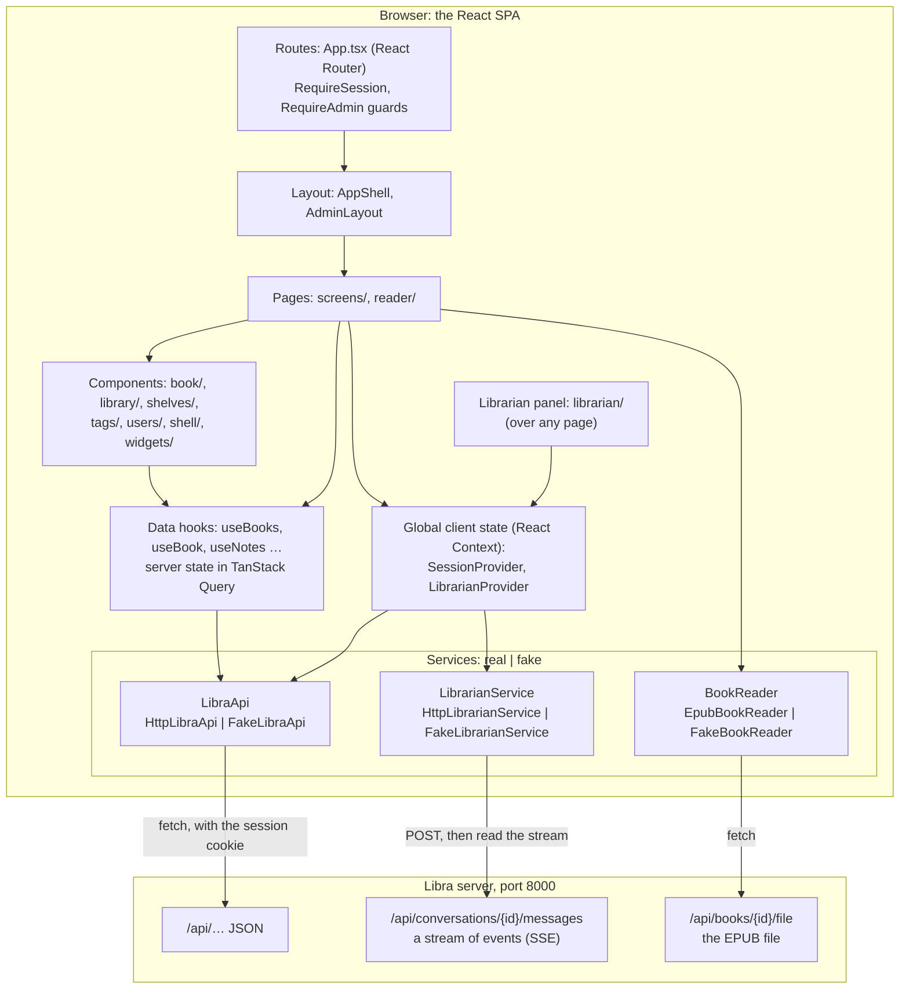
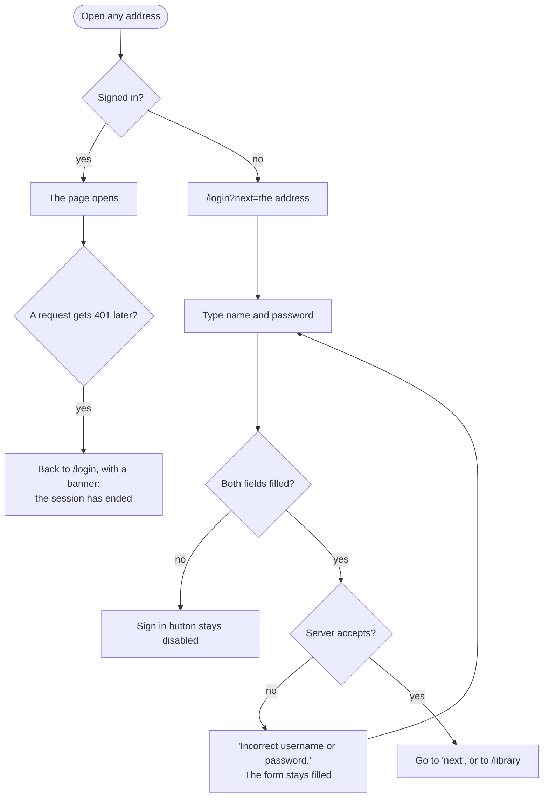
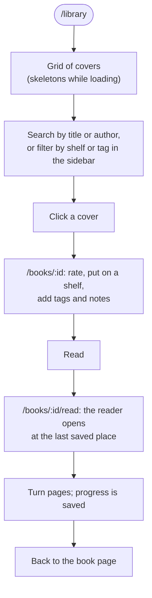
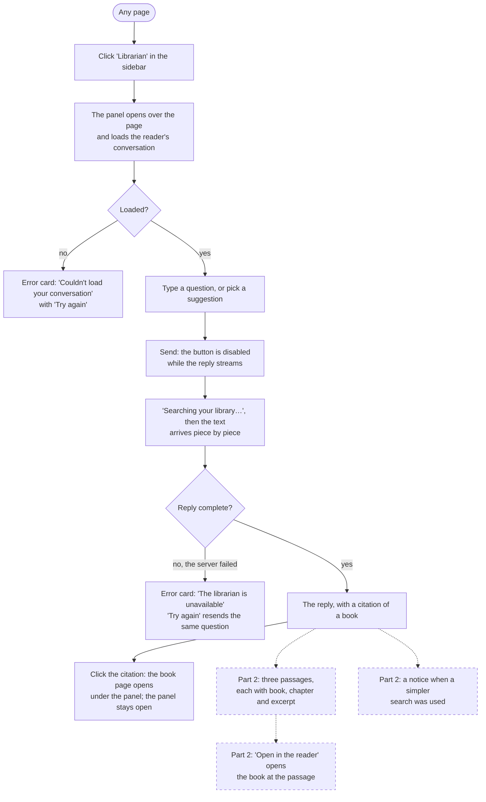

# Libra: the front-end block

This page is for the expert who checks the front-end part of the diploma
project "A Passage Retrieval System for an E-book Library Using LLM-Generated
Semantic Descriptors". It says how to run the project, and where each
requirement of the "Front-End Architecture and Development" rubric is met.
The project aims at the **minimum requirements (5 points)**.

| | |
|---|---|
| Repository | https://github.com/eugene-chekan/libra (public, read access for everybody) |
| The web client | the folder [`web/`](https://github.com/eugene-chekan/libra/tree/main/web) on the branch `main` |
| This page | the folder `docs/frontend/` on the branch `docs/diploma` |
| The API the client uses | [api.md](api.md), and the full schema [openapi.json](openapi.json) |
| **Deployed application** | **[https://libra-production-7f573af6.up.railway.app](https://libra-production-7f573af6.up.railway.app)**, on Railway. Sign in with the demo account that comes with this page |

## Which part is the diploma's work

Libra is a self-hosted e-book library with a web client. The client is one
application, and this page describes all of it, because the rubric is about
the whole application. But only one part of it is the diploma's own work.

| Part of the client | When it was built | Part of the diploma? |
|---|---|---|
| Library, book page, shelves, tags, notes, reader, accounts, admin pages | Phase 4, August to September 2026, before the diploma topic was set | No. It is the platform that the diploma builds on |
| **The Librarian panel**: the chat shell, the streamed reply, its errors | Phase 4, 1 September 2026 | It is the place where the diploma's result appears |
| **The Librarian panel shows the found passages**, each with book and chapter, and opens the book at the passage | Part 2 of the diploma, due for the pre-defense on 6 January 2027 | **Yes. This is the diploma's front-end work** |

**Today the panel is not connected to search.** It has a "NOT CONNECTED"
badge and gives fixed example replies. The passage search is built in Part 1
of the diploma (the retrieval experiment). Part 2 then puts the found passages
into this panel. The layouts for Part 2 are in the business analysis block,
Section 2.5 (stories US-4.1, US-4.2 and US-3.3).

So wherever the Librarian has an example of a requirement, the tables below
name it first, in bold.

## How to run

### The deployed copy

Open **[https://libra-production-7f573af6.up.railway.app](https://libra-production-7f573af6.up.railway.app)** and sign in with the demo account that comes with this
page. It runs release 0.2.6, built from `main`, and the library holds a few
public-domain books. Things to try:

- **The Librarian:** the "Librarian" button in the sidebar opens the panel over
  the page. Ask a question, and the reply streams in.
- **Forms and validation:** open a book and edit it, or set a Kindle address
  in the account menu.
- **The phone layout:** make the window narrower than 768 px.
- **The API:** [https://libra-production-7f573af6.up.railway.app/docs](https://libra-production-7f573af6.up.railway.app/docs) lists every call, and each one can be tried
  there.

To run it yourself, there are three ways.

### Way 1: the ready Docker image

You need Docker and Git.

```bash
git clone https://github.com/eugene-chekan/libra.git
```

```bash
cd libra
```

```bash
LIBRA_VERSION=0.2.6 docker compose -f scripts/docker-compose.yml up -d
```

Docker downloads the image of release 0.2.6. Then create the first account.
The command asks for a password:

```bash
docker compose -f scripts/docker-compose.yml exec backend python -m app.cli create-admin --username admin
```

Open http://localhost:8000 and sign in. The library is empty: add an EPUB
file with the "Add book" button. Any EPUB from
[Standard Ebooks](https://standardebooks.org) works. The Librarian button is
in the sidebar.

### Way 2: from the source code

You need Python 3.12 or newer, [uv](https://docs.astral.sh/uv/) and Node.js 22
or newer. From the repository root:

```bash
LIBRA_ADMIN_PASSWORD=choose-one scripts/run.sh --scratch
```

On Windows, in PowerShell 7:

```powershell
$env:LIBRA_ADMIN_PASSWORD = "choose-one"; scripts\run.ps1 -Scratch
```

The script builds the web client, installs the server, and serves both on
http://localhost:8000. Sign in as `admin` with the password you chose.
`--scratch` keeps the data in a folder that is deleted at every start.

### Way 3: the client alone, for development

Start the server as in Way 2. Then, in a second terminal, from `web/`:

```bash
npm ci
```

```bash
npm run dev
```

This serves the client at http://localhost:5173 and forwards every `/api`
request to the server on port 8000. A change in the code shows in the browser
at once.

### Tests and checks

From `web/`:

| Command | What it runs |
|---|---|
| `npm test` | All component tests (Vitest). No server needed |
| `npm run e2e` | All end-to-end tests in a real browser (Playwright). Needs a server, see below |
| `npm run lint` | ESLint, including the accessibility rules |
| `npm run format:check` | Prettier: fails on any badly formatted file |
| `npm run typecheck` | The TypeScript compiler, with no output files |
| `npm run build` | The type check, then a production build into `dist/` |

The end-to-end tests need a browser once: `npx playwright install chromium`.
They also need a real server with a test account. The steps are in
[web/README.md](https://github.com/eugene-chekan/libra/blob/main/web/README.md#commands).

## The minimum requirements, one by one

### Documentation

| Requirement | Where |
|---|---|
| Architecture diagram: modules, components, routes, state | [Architecture](#architecture) |
| Architecture approach | [The approach](#the-approach) |
| API documentation: schemas, methods, examples | [api.md](api.md) and [openapi.json](openapi.json) |
| User flows | [User flows](#user-flows). **Flow 3 is the Librarian** |
| Tech stack justification: framework, state, UI kit | [Tech stack, and why](#tech-stack-and-why) |

### Architecture

| Requirement | Where | Notes |
|---|---|---|
| Components | **[`LibrarianPanel.tsx`](https://github.com/eugene-chekan/libra/blob/main/web/src/librarian/LibrarianPanel.tsx), [`MessageBubble.tsx`](https://github.com/eugene-chekan/libra/blob/main/web/src/librarian/MessageBubble.tsx)**; [`book/`](https://github.com/eugene-chekan/libra/tree/main/web/src/book), [`library/`](https://github.com/eugene-chekan/libra/tree/main/web/src/library), [`widgets/`](https://github.com/eugene-chekan/libra/tree/main/web/src/widgets) | [Project structure](#project-structure) |
| Pages | [`web/src/screens/`](https://github.com/eugene-chekan/libra/tree/main/web/src/screens), [`ReaderScreen.tsx`](https://github.com/eugene-chekan/libra/blob/main/web/src/reader/ReaderScreen.tsx) | Eight pages |
| Services and hooks | **[`HttpLibrarianService.ts`](https://github.com/eugene-chekan/libra/blob/main/web/src/librarian/HttpLibrarianService.ts), [`LibrarianProvider.tsx`](https://github.com/eugene-chekan/libra/blob/main/web/src/librarian/LibrarianProvider.tsx)**; [`HttpLibraApi.ts`](https://github.com/eugene-chekan/libra/blob/main/web/src/api/HttpLibraApi.ts), hooks such as [`useBooks.ts`](https://github.com/eugene-chekan/libra/blob/main/web/src/library/useBooks.ts) | Each service is an interface with a real and a fake version |
| Routing, at least 3–4 routes | [`routes.ts`](https://github.com/eugene-chekan/libra/blob/main/web/src/routes.ts), the route table in [`App.tsx`](https://github.com/eugene-chekan/libra/blob/main/web/src/App.tsx) | Ten routes: eight pages and two redirects, behind two route guards. [The pages](#the-pages) |
| Local and global state | [State](#state) | TanStack Query and React Context, and why there is no Redux |
| Project structure | [Project structure](#project-structure) | Components, pages, services, data models (`api/types.ts`), styles (`theme/` and one CSS Module per component) |
| Real API | [api.md](api.md) | The client always talks to the real Libra server. The tests use a fake service in its place |
| Data types | [`api/types.ts`](https://github.com/eugene-chekan/libra/blob/main/web/src/api/types.ts) | TypeScript everywhere, in strict mode |
| Central request handling | `request()` in [`HttpLibraApi.ts`](https://github.com/eugene-chekan/libra/blob/main/web/src/api/HttpLibraApi.ts) | One `fetch` wrapper for all 34 calls. It sends the cookie, reads errors and reports every 401 |
| Errors and loading states | [Errors](#errors), [Loading states](#loading-states) | |

### Implementation

| Requirement | Where | Notes |
|---|---|---|
| A bundler | [`vite.config.ts`](https://github.com/eugene-chekan/libra/blob/main/web/vite.config.ts) | Vite 8 |
| Component-based UI | 68 component files in 14 folders | No component holds a whole page of logic |
| Reusable components | [`widgets/`](https://github.com/eugene-chekan/libra/tree/main/web/src/widgets): `ErrorBlock`, `Skeleton`, `EmptyState`, `Modal`, `ConfirmDialog`, `Tooltip`, `Icon` | `ErrorBlock` alone is used in 12 files |
| Layout components | [`AppShell.tsx`](https://github.com/eugene-chekan/libra/blob/main/web/src/shell/AppShell.tsx) (sidebar and page frame), [`AdminLayout.tsx`](https://github.com/eugene-chekan/libra/blob/main/web/src/screens/AdminLayout.tsx) (the admin tabs) | |
| UI library or custom components | Custom components on Radix UI | [Tech stack](#tech-stack-and-why) |
| Controlled forms | **The question box in `LibrarianPanel.tsx`**; [`BookEditForm.tsx`](https://github.com/eugene-chekan/libra/blob/main/web/src/book/BookEditForm.tsx), [`LoginScreen.tsx`](https://github.com/eugene-chekan/libra/blob/main/web/src/screens/LoginScreen.tsx) | Every input's value lives in React state |
| Form validation | [`checkBookFields`](https://github.com/eugene-chekan/libra/blob/main/web/src/book/BookFields.tsx) | [Forms and validation](#forms-and-validation) |
| Lists and tables | **The message list in the Librarian panel**; the book grid, the users table, the notes list, the shelf list | |
| Search, filter, sort | [`SearchBar.tsx`](https://github.com/eugene-chekan/libra/blob/main/web/src/library/SearchBar.tsx) (search by title or author); the sidebar filters by shelf and by tag ([`filterParams.ts`](https://github.com/eugene-chekan/libra/blob/main/web/src/library/filterParams.ts)) | Search and filters live in the page address, so a filtered view can be bookmarked. The grid is sorted by title; there is no sort control |
| Responsive layout | [`breakpoints.ts`](https://github.com/eugene-chekan/libra/blob/main/web/src/theme/breakpoints.ts), [`AppShell.tsx`](https://github.com/eugene-chekan/libra/blob/main/web/src/shell/AppShell.tsx) | Below 768 px the sidebar becomes a drawer, and the **Librarian panel** covers the whole screen. Checked by [`e2e/shell.spec.ts`](https://github.com/eugene-chekan/libra/blob/main/web/e2e/shell.spec.ts) at 390 px and at the 767/768 px edge |
| ESLint and Prettier | [`eslint.config.js`](https://github.com/eugene-chekan/libra/blob/main/web/eslint.config.js), [`.prettierrc`](https://github.com/eugene-chekan/libra/blob/main/web/.prettierrc) | CI fails on a lint error or a badly formatted file |
| Basic logging | [`api/errors.ts`](https://github.com/eugene-chekan/libra/blob/main/web/src/api/errors.ts), [`ErrorBoundary.tsx`](https://github.com/eugene-chekan/libra/blob/main/web/src/widgets/ErrorBoundary.tsx) | Every failed request and every crash is written to the browser console. [Logging](#logging) |

### Error handling

| Requirement | Where | Notes |
|---|---|---|
| A global error handler | `request()` in [`HttpLibraApi.ts`](https://github.com/eugene-chekan/libra/blob/main/web/src/api/HttpLibraApi.ts) and the 401 handler in [`SessionProvider.tsx`](https://github.com/eugene-chekan/libra/blob/main/web/src/session/SessionProvider.tsx) for requests; [`ErrorBoundary.tsx`](https://github.com/eugene-chekan/libra/blob/main/web/src/widgets/ErrorBoundary.tsx) for crashes | The request wrapper works like an interceptor: every response passes through it. The error boundary wraps the whole app |
| Clear messages | [`messageFor()`](https://github.com/eugene-chekan/libra/blob/main/web/src/api/errors.ts), [`ErrorBlock`](https://github.com/eugene-chekan/libra/blob/main/web/src/widgets/ErrorBlock.tsx) | An inline alert where the action happened, not a toast |
| 401, 403, 404, 500 | [`errors.ts`](https://github.com/eugene-chekan/libra/blob/main/web/src/api/errors.ts), [`SessionProvider.tsx`](https://github.com/eugene-chekan/libra/blob/main/web/src/session/SessionProvider.tsx) | [Errors](#errors) |
| Loading states for every async action | [`Skeleton.tsx`](https://github.com/eugene-chekan/libra/blob/main/web/src/widgets/Skeleton.tsx), **the streamed reply in `MessageBubble.tsx`** | [Loading states](#loading-states) |

### Testing

| Requirement | Where | Notes |
|---|---|---|
| Unit tests, at least 3 key components | **[`LibrarianPanel.test.tsx`](https://github.com/eugene-chekan/libra/blob/main/web/src/librarian/LibrarianPanel.test.tsx)**, [`LoginScreen.test.tsx`](https://github.com/eugene-chekan/libra/blob/main/web/src/screens/LoginScreen.test.tsx), [`BookEditForm.test.tsx`](https://github.com/eugene-chekan/libra/blob/main/web/src/book/BookEditForm.test.tsx), [`AddBookModal.test.tsx`](https://github.com/eugene-chekan/libra/blob/main/web/src/addBook/AddBookModal.test.tsx) | 82 test files, 731 tests, all passing on 2026-11-24. [Tests](#tests) |
| 1–2 e2e tests | **[`e2e/librarian.spec.ts`](https://github.com/eugene-chekan/libra/blob/main/web/e2e/librarian.spec.ts)**, [`e2e/auth.spec.ts`](https://github.com/eugene-chekan/libra/blob/main/web/e2e/auth.spec.ts) | 11 spec files, 74 tests |
| Forms, states, API logic tested | `BookEditForm.test.tsx` (form), `LibrarianPanel.test.tsx` (states), [`HttpLibrarianService.test.ts`](https://github.com/eugene-chekan/libra/blob/main/web/src/librarian/HttpLibrarianService.test.ts) (API logic) | |

### Restrictions

| The rubric does not allow | In Libra |
|---|---|
| Inline styles without a reason; no CSS architecture | One CSS Module per component, and shared values as CSS variables in [`tokens.css`](https://github.com/eugene-chekan/libra/blob/main/web/src/theme/tokens.css). There are 10 inline `style` attributes, and each one holds a value computed at run time: a progress bar's width, a cover's colour made from the book's number, a chapter's indent |
| One component for the whole project | 68 components |
| Tokens or passwords in the code | None. The session lives in an `HttpOnly` cookie, which the client's code cannot read. The only passwords in the repository are test values for the tests, such as `e2e-password` |
| Unhandled API errors | Every request goes through `request()`, every screen shows its error, and every failure is logged. See [Errors](#errors) |
| `any` without a reason | No `any` in the client's code. ESLint's `typescript-eslint` rules forbid it |
| Static HTML pages | One HTML page; React builds every screen |

## Architecture

The server (Python, FastAPI) serves both the client and the API from one
address. The browser loads the client from port 8000 and sends every data
request to `/api` on the same port. So the client never needs to know the
server's address.



### The approach

The client is **component-based**, with the data split by where it comes
from. It does not use Flux or Redux, and it has no micro frontends.

1. **A page or a component never calls `fetch` itself.** It calls a hook, and
   the hook calls a service. Only the three `Http...` classes know about
   addresses and HTTP.
2. **Each service is an interface.** `App.tsx` gives the real version to the
   whole client once, through React Context (a way to pass a value to every
   component below it). A test gives the fake version in the same way, so
   every component test runs with no server.
3. **The fake follows the server's rules.** When the server refuses
   something, the fake refuses it with the same status and the same sentence.
   So a test that passes with the fake shows what the reader will see with the
   server.
4. **Each kind of state has one home.** See [State](#state).

**The Librarian panel is not a page.** It opens over whatever page is open,
so the reader keeps their place in the library. A citation in a reply opens
the book on the page underneath, and the panel stays open. The reasons are in
[librarian-panel.md](https://github.com/eugene-chekan/libra/blob/main/docs/specs/librarian-panel.md#why-a-panel-not-a-page).

**The reply arrives as a stream.** The server sends the reply in small pieces
(Server-Sent Events, SSE: one HTTP response that stays open and sends one
event at a time). `HttpLibrarianService` reads the stream itself, because the
browser's built-in `EventSource` cannot send a question in a POST request.

### State

| Kind of state | Where it lives | Examples |
|---|---|---|
| Local | `useState` inside one component | The text in a form field, whether a menu is open |
| In the address | The page address (React Router) | The search text and the shelf and tag filters of the library |
| Server data | TanStack Query's cache, through hooks | Books, shelves, tags, notes, users |
| Global client state | Two React Context providers | Who is signed in ([`SessionProvider`](https://github.com/eugene-chekan/libra/blob/main/web/src/session/SessionProvider.tsx)); **the Librarian's conversation, the reply being streamed, and its errors ([`LibrarianProvider`](https://github.com/eugene-chekan/libra/blob/main/web/src/librarian/LibrarianProvider.tsx))** |

**Why there is no Redux or Zustand.** Almost all the state in Libra is server
data: books, shelves, tags. TanStack Query already keeps it, shares it between
components, and refreshes it after a change. What is left for a global store
is two things: the session and the Librarian. Two Context providers hold them
with no extra library. A Redux store would add actions and reducers around
these two values, and a second copy of server data that could disagree with
the cache.

### The pages

| Address | Page | Who can open it |
|---|---|---|
| `/login` | Sign in | Everybody |
| `/library` | All books, with search and filters | A signed-in reader |
| `/books/:id` | One book: rating, shelf, tags, notes, edit | A signed-in reader |
| `/books/:id/read` | The reader | A signed-in reader |
| `/shelves` | The reader's shelves and tags | A signed-in reader |
| `/admin/users`, `/admin/maintenance` | Accounts, and checks of the stored files | An admin |
| any other address | "Not found" | A signed-in reader |

The Librarian panel opens over any of these pages except `/login`.

### Project structure

| Folder of `web/src/` | What is in it | Examples |
|---|---|---|
| `screens/` | The pages. Each one reads its data with hooks and puts components together | `LibraryScreen`, `BookScreen`, `ShelvesScreen`, `LoginScreen`, `AdminUsersScreen` |
| `reader/` | The reading page and the EPUB reader service | `ReaderScreen`, `EpubBookReader` |
| **`librarian/`** | **The Librarian panel, its state, and its service** | **`LibrarianPanel`, `MessageBubble`, `LibrarianProvider`, `HttpLibrarianService`** |
| `library/`, `book/`, `shelves/`, `tags/`, `users/`, `addBook/` | Components and data hooks of one feature | `BookCard`, `BookEditForm`, `NotesPanel`, `ShelfManager`, `AddBookModal`, `useBooks` |
| `shell/` | The frame around every page: the sidebar and its filters | `AppShell`, `Sidebar`, `AccountRow` |
| `widgets/` | Small parts used everywhere | `ErrorBlock`, `Skeleton`, `EmptyState`, `Modal`, `ConfirmDialog`, `Icon` |
| `api/` | The main service, its fake, the data types and the errors | `LibraApi`, `HttpLibraApi`, `FakeLibraApi`, `types.ts`, `errors.ts` |
| `session/` | Who is signed in, and the route guards | `SessionProvider`, `RequireSession`, `RequireAdmin` |
| `theme/` | Colours, fonts and sizes, as CSS variables; the phone width | `tokens.css`, `breakpoints.ts` |

Each component has its styles next to it, in a file with the same name:
`LibrarianPanel.tsx` and `LibrarianPanel.module.css`. Its tests are next to
it too: `LibrarianPanel.test.tsx`.

## User flows

### Flow 1: sign in, and a session that ends



### Flow 2: find a book and read it



### Flow 3: ask the Librarian (the diploma's part)

The solid boxes work today. The dashed boxes are Part 2 of the diploma.



## Tech stack, and why

| Tool | What it does here | Why this one |
|---|---|---|
| **React 19** | The framework: builds the screens from components | The largest set of libraries and test tools. Radix UI, TanStack Query and Testing Library all target it |
| **TypeScript** | Types for every component and API call | A wrong field name or a missing case fails the build, not the reader's screen. The types in `api/types.ts` follow the server's OpenAPI schema |
| **Vite 8** | The bundler and the development server | Fast builds. Its development server forwards `/api` to the Libra server, so the browser sees one address and the session cookie works with no extra setup |
| **React Router 7** | Pages with real addresses | A page can be bookmarked and shared, and the browser's Back button works |
| **TanStack Query 5** | The state manager for server data: loading, cache, errors | Every request gives one value with three states: loading, error, or data. So no page can forget its loading or error state. See [State](#state) for why there is no Redux |
| **Radix UI**, restyled | The base of the UI kit: dialogs, menus, tooltips, with no styles | Correct keyboard and screen-reader behaviour, which is hard to build by hand. A ready kit such as Material would bring its own look; Libra's look comes from its own CSS. The custom components on top are in `widgets/` |
| **CSS Modules** and CSS variables | Styles | Each component's styles stay inside it. The colours and sizes live once, in `tokens.css` |
| **epub.js** | Shows an EPUB book in the browser | The only maintained library that pages an EPUB in a browser |
| **Vitest** and **React Testing Library** | Component tests | Vitest reads Vite's own configuration. Testing Library finds elements the way a reader does: by their text and role |
| **Playwright** | End-to-end tests in a real browser, against a real server | Real Chromium, real network, real cookies |
| **ESLint** with `jsx-a11y`, and **Prettier** | Lint, accessibility rules, formatting | CI fails on an image with no text alternative, a click handler on a non-button, or a badly formatted file |

The fonts are part of the build, not loaded from the internet. Libra is a
local-first application: it must work in a home network with no internet
access.

More reasons are in
[phase-4-plan.md](https://github.com/eugene-chekan/libra/blob/main/docs/specs/phase-4-plan.md#technical-decisions).

## Forms and validation

Every form is controlled: React state holds the value of each field. Each form
checks its input in the browser first, so the reader sees a clear sentence and
no request is sent. If the server refuses, the form stays open and shows the
server's sentence.

| Form | Where | Rules checked in the browser |
|---|---|---|
| **Question to the Librarian** | [`LibrarianPanel.tsx`](https://github.com/eugene-chekan/libra/blob/main/web/src/librarian/LibrarianPanel.tsx) | An empty question, or only spaces, cannot be sent: the Send button is disabled. A second question cannot be sent while a reply streams. Enter sends; Shift+Enter adds a new line |
| Sign in | [`LoginScreen.tsx`](https://github.com/eugene-chekan/libra/blob/main/web/src/screens/LoginScreen.tsx) | The button is disabled until both fields are filled |
| Edit a book | `checkBookFields` in [`BookFields.tsx`](https://github.com/eugene-chekan/libra/blob/main/web/src/book/BookFields.tsx), used by [`BookEditForm.tsx`](https://github.com/eugene-chekan/libra/blob/main/web/src/book/BookEditForm.tsx) and [`AddBookModal.tsx`](https://github.com/eugene-chekan/libra/blob/main/web/src/addBook/AddBookModal.tsx) | A title and an author are required. The year must be a number. The page count must be a whole number, 1 or more |
| Add a book | [`AddBookModal.tsx`](https://github.com/eugene-chekan/libra/blob/main/web/src/addBook/AddBookModal.tsx) | The file picker takes only `.epub`. A file that is too large or broken gets the server's sentence |
| New shelf, new tag, new note | [`ShelfManager.tsx`](https://github.com/eugene-chekan/libra/blob/main/web/src/shelves/ShelfManager.tsx), [`TagManager.tsx`](https://github.com/eugene-chekan/libra/blob/main/web/src/tags/TagManager.tsx), [`NotesPanel.tsx`](https://github.com/eugene-chekan/libra/blob/main/web/src/book/NotesPanel.tsx) | The text is trimmed, and an empty one is not sent. The tag form says "one word, with no spaces" |
| New account (admin) | [`AddUserRow.tsx`](https://github.com/eugene-chekan/libra/blob/main/web/src/users/AddUserRow.tsx) | A name and a password are required |
| Kindle address | `checkKindleEmail` in [`KindleEmailModal.tsx`](https://github.com/eugene-chekan/libra/blob/main/web/src/widgets/KindleEmailModal.tsx) | It must look like an e-mail address: one `@`, text on both sides, a dot after it. An empty box removes the address. A failed save keeps the dialog open with the reason |

The server checks every one of these rules again (status 422), so another
program cannot get around them either.

## Errors

Errors are handled at four levels.

1. **Every failed request becomes one kind of error.** `request()` in
   [`HttpLibraApi.ts`](https://github.com/eugene-chekan/libra/blob/main/web/src/api/HttpLibraApi.ts)
   turns every failure into an `ApiError` with the HTTP status, and a network
   failure into status 0. `messageFor()` in
   [`errors.ts`](https://github.com/eugene-chekan/libra/blob/main/web/src/api/errors.ts)
   turns any error into the one sentence the reader sees. No component writes
   its own text for a failed request.
2. **An ended session is handled once, for the whole client.** Every 401
   answer goes to one handler in
   [`SessionProvider.tsx`](https://github.com/eugene-chekan/libra/blob/main/web/src/session/SessionProvider.tsx).
   It marks the session as ended, and the route guard sends the reader to the
   login page with a banner. After the sign-in, the reader returns to the page
   they were on.
3. **Every error on screen looks the same and can be retried.**
   [`ErrorBlock`](https://github.com/eugene-chekan/libra/blob/main/web/src/widgets/ErrorBlock.tsx)
   shows the sentence and a "Try again" button. It has the role `alert`, so a
   screen reader reads it out. **The Librarian panel** has its own error card
   in the same form: "Try again" sends the same question again, even after the
   question box was cleared.
4. **A crash gets a page of its own.** An error thrown while a component
   builds the screen is not a failed request, so no screen can show it.
   [`ErrorBoundary`](https://github.com/eugene-chekan/libra/blob/main/web/src/widgets/ErrorBoundary.tsx)
   wraps the whole app and catches it. It shows a card in the same error
   shape: "Something went wrong", one sentence, and a "Reload the page"
   button. Without it, the page would go blank.

| Status | What the reader sees |
|---|---|
| No answer (network) | "Could not reach the server." |
| 401 | On the login page: "Incorrect username or password." Anywhere else: the session ends, and the login page opens with a banner |
| 403 | "You are not allowed to do that." Admin pages are also hidden from a reader by the `RequireAdmin` guard |
| 404 | "That is no longer there." An unknown address shows the "Not found" page |
| 409, 422 | The server's own sentence, for example "You already have a shelf with that name" |
| 500 and other 5xx | The server's own sentence when it sends one, such as "Kindle delivery is not configured on this server". Otherwise "The server ran into a problem. Try again in a moment." |

Requests are never repeated automatically
([`queryClient.ts`](https://github.com/eugene-chekan/libra/blob/main/web/src/queryClient.ts)).
The "Try again" button is the one way to repeat a request, so the reader sees
what happens.

### Logging

Every failure is written to the browser console, with `libra:` in front, so
it can be found among other messages.

| What failed | Level | Where | Example line |
|---|---|---|---|
| A request that never reached the server | error | `networkFailure()` in [`errors.ts`](https://github.com/eugene-chekan/libra/blob/main/web/src/api/errors.ts) | `libra: GET /api/books failed (0): Could not reach the server.` |
| A request the server failed (5xx) | error | `responseFailure()` in [`errors.ts`](https://github.com/eugene-chekan/libra/blob/main/web/src/api/errors.ts) | `libra: GET /api/books/7 failed (500): The server ran into a problem. Try again in a moment.` |
| A request the server refused (4xx) | warning | `responseFailure()` in [`errors.ts`](https://github.com/eugene-chekan/libra/blob/main/web/src/api/errors.ts) | `libra: POST /api/shelves was refused (409): You already have a shelf with that name` |
| A 401 | not logged | — | Every visit before signing in gets one, so it says nothing |
| A crash in a component | error | `componentDidCatch()` in [`ErrorBoundary.tsx`](https://github.com/eugene-chekan/libra/blob/main/web/src/widgets/ErrorBoundary.tsx) | `libra: a screen crashed`, then the error and the component it came from |

Both services (`HttpLibraApi` and `HttpLibrarianService`) build their errors
through the same two functions. So a failed request cannot be shown without
being logged, and the rule for the level is in one place.

## Loading states

| Where | What the reader sees |
|---|---|
| **Librarian reply** | "Searching your library…", then the text arrives piece by piece ([`MessageBubble.tsx`](https://github.com/eugene-chekan/libra/blob/main/web/src/librarian/MessageBubble.tsx)). The Send button is disabled until the reply ends |
| Library grid, book page, shelves, admin pages | Grey shapes in the place of the content ([`Skeleton.tsx`](https://github.com/eugene-chekan/libra/blob/main/web/src/widgets/Skeleton.tsx)), so the page does not jump when the data arrives |
| Every form | The submit button is disabled while the request runs, so a double click cannot save twice |
| Book upload | A busy state in the upload window until the server answers |
| Start of the app | Nothing is shown until the client knows whether the reader is signed in, so the login page never flashes for a signed-in reader |

## Tests

The client has **82 test files with 731 component tests**, all passing on
2026-11-24, and **74 end-to-end tests in 11 files**. CI runs the component
tests, the type check, the lint and the format check on every pull request.

**Four key components.** Each test file renders the component with the fake
service and checks what is on the screen.

| Component | Test file | What the tests check |
|---|---|---|
| **LibrarianPanel** | [`LibrarianPanel.test.tsx`](https://github.com/eugene-chekan/libra/blob/main/web/src/librarian/LibrarianPanel.test.tsx), 13 tests | The suggestions use a real book title; a suggestion sends, and the reply streams in; the search status, then the citation that opens the book with the panel still open; the load error card; the "unavailable" card, and that "Try again" resends the failed text; Enter and Shift+Enter; closing by button, Escape and outside click |
| LoginScreen | [`LoginScreen.test.tsx`](https://github.com/eugene-chekan/libra/blob/main/web/src/screens/LoginScreen.test.tsx), 7 tests | The button is disabled until both fields are filled; a sign-in goes to `next` or to the library; Enter submits; the "session ended" banner shows only after a real session ended |
| BookEditForm | [`BookEditForm.test.tsx`](https://github.com/eugene-chekan/libra/blob/main/web/src/book/BookEditForm.test.tsx), 9 tests | An empty title, a year that is not a number, and a bad page count are refused before any request; Save writes every field; Cancel writes nothing; a server refusal keeps the form open with the reason |
| AddBookModal | [`AddBookModal.test.tsx`](https://github.com/eugene-chekan/libra/blob/main/web/src/addBook/AddBookModal.test.tsx), 15 tests | Only EPUB files; the busy state during the upload; server refusals; the parsed fields that an admin can change; Done disabled while saving |

The Librarian's state and service have their own tests too:
[`LibrarianProvider.test.tsx`](https://github.com/eugene-chekan/libra/blob/main/web/src/librarian/LibrarianProvider.test.tsx)
and
[`HttpLibrarianService.test.ts`](https://github.com/eugene-chekan/libra/blob/main/web/src/librarian/HttpLibrarianService.test.ts),
which checks how the event stream is read, and that a failed request is
logged. The error boundary has its own tests too:
[`ErrorBoundary.test.tsx`](https://github.com/eugene-chekan/libra/blob/main/web/src/widgets/ErrorBoundary.test.tsx).

**End-to-end tests.** Playwright drives a real Chromium against a real Libra
server. Two of them match this requirement best:

| File | What it checks |
|---|---|
| **[`librarian.spec.ts`](https://github.com/eugene-chekan/libra/blob/main/web/e2e/librarian.spec.ts), 3 tests** | The panel opens over the library; a question reaches the server, and the reply streams back with a citation; a click on the citation opens the book under the panel; Escape closes the panel |
| [`auth.spec.ts`](https://github.com/eugene-chekan/libra/blob/main/web/e2e/auth.spec.ts), 4 tests | Signing in and out against the real server, and a wrong password |

The other nine files cover the library, the book page, shelves, tags, the
upload, the reader, the phone layout and the admin pages.

## What is not done yet

- **The Librarian panel does not show passages yet.** That is Part 2 of the
  diploma, due on 6 January 2027. Today the panel gives fixed example replies
  and says so on screen.
