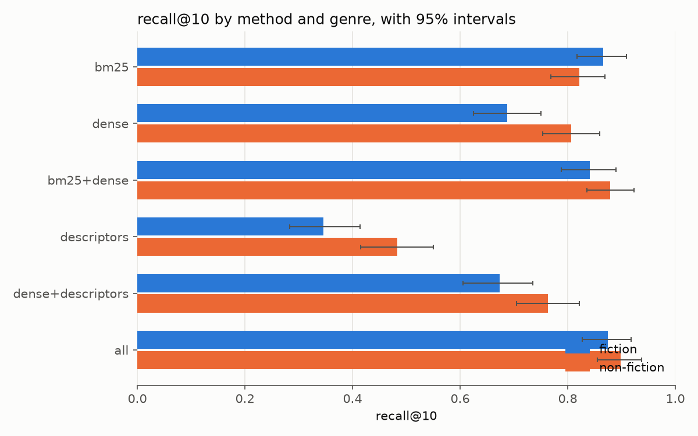

# Report

All numbers are recall@10: the share of questions whose source chunk is in a
method's first 10. Intervals are 95% percentile bootstrap intervals,
10,000 resamples, seed 20261122. p-values are two-sided randomisation tests.
The main family (H1, H2 per genre, and H3) is Holm-corrected at 0.05; H4 is not.

## The hypotheses

| Test | Comparison | Questions | Difference (points) | Interval | p | p (Holm) |
|---|---|---|---|---|---|---|
| H1 fiction | dense+descriptors vs dense, fiction | 208 | -1.4 | -8.2 to +5.3 | 0.8003 | 1.0000 |
| H1 non-fiction | dense+descriptors vs dense, non-fiction | 207 | -4.3 | -11.1 to +1.9 | 0.2516 | 0.7547 |
| H2 fiction | dense+descriptors vs bm25+dense, fiction | 208 | -16.8 | -23.1 to -10.6 | 0.0002 | 0.0010 |
| H2 non-fiction | dense+descriptors vs bm25+dense, non-fiction | 207 | -11.6 | -18.4 to -5.3 | 0.0008 | 0.0032 |
| H3 | H1 gain on fiction vs on non-fiction | 415 | +2.9 | -6.3 to +12.1 | 0.6273 | 1.0000 |
| H4 | H1 gain on interpretive vs on factual | 415 | +7.8 | -1.4 to +17.0 | 0.1224 | — |

## recall@10 by method and genre

| Method | Genre | Questions | recall | Interval |
|---|---|---|---|---|
| bm25 | all | 415 | 0.843 | 0.807 to 0.877 |
| bm25 | fiction | 208 | 0.865 | 0.817 to 0.909 |
| bm25 | non-fiction | 207 | 0.821 | 0.768 to 0.870 |
| dense | all | 415 | 0.747 | 0.704 to 0.788 |
| dense | fiction | 208 | 0.688 | 0.625 to 0.750 |
| dense | non-fiction | 207 | 0.807 | 0.754 to 0.860 |
| bm25+dense | all | 415 | 0.860 | 0.827 to 0.894 |
| bm25+dense | fiction | 208 | 0.841 | 0.788 to 0.889 |
| bm25+dense | non-fiction | 207 | 0.879 | 0.836 to 0.923 |
| descriptors | all | 415 | 0.414 | 0.369 to 0.463 |
| descriptors | fiction | 208 | 0.346 | 0.284 to 0.413 |
| descriptors | non-fiction | 207 | 0.483 | 0.415 to 0.551 |
| dense+descriptors | all | 415 | 0.718 | 0.675 to 0.761 |
| dense+descriptors | fiction | 208 | 0.673 | 0.606 to 0.736 |
| dense+descriptors | non-fiction | 207 | 0.763 | 0.705 to 0.821 |
| all | all | 415 | 0.887 | 0.855 to 0.916 |
| all | fiction | 208 | 0.875 | 0.827 to 0.918 |
| all | non-fiction | 207 | 0.899 | 0.855 to 0.937 |

